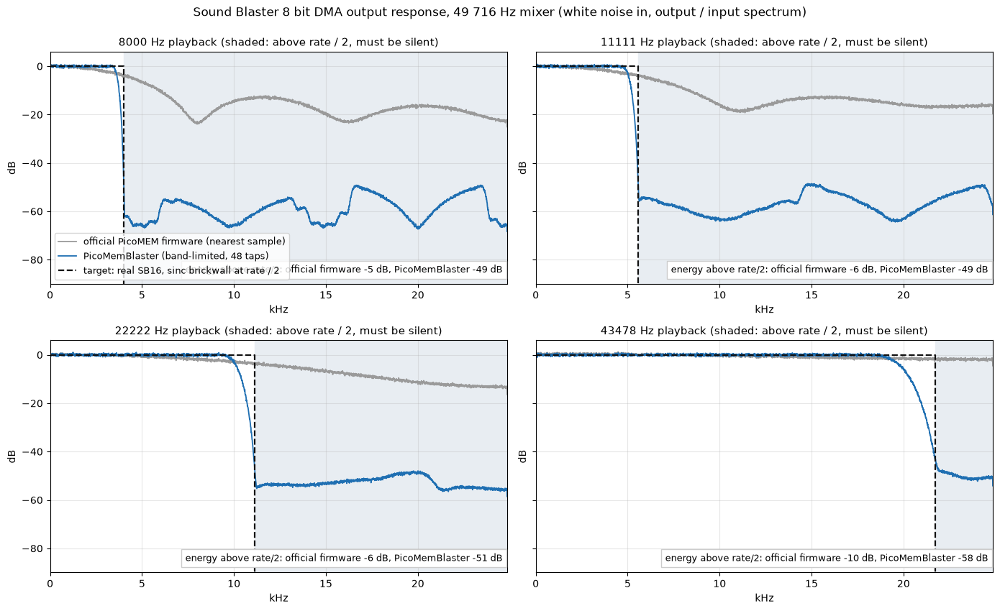
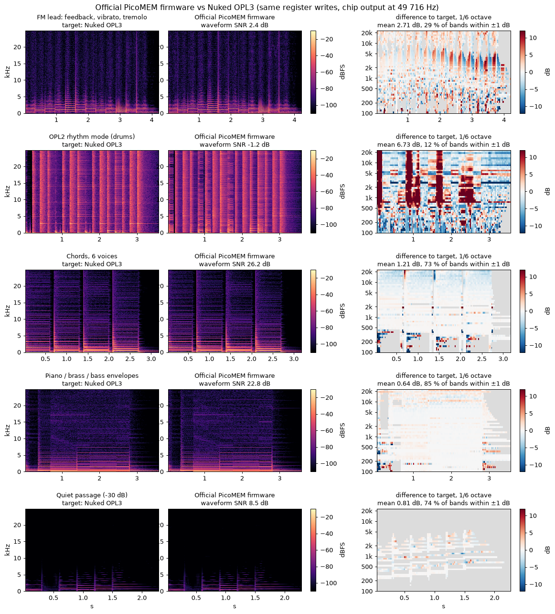
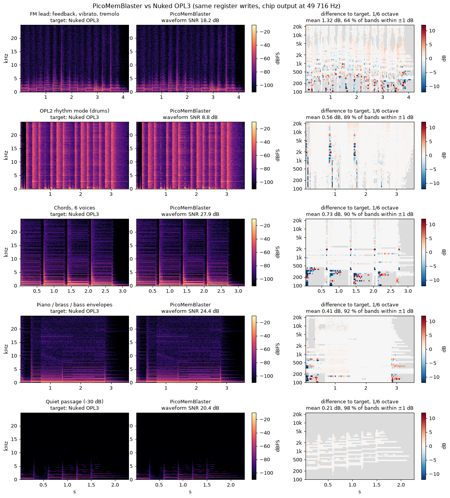
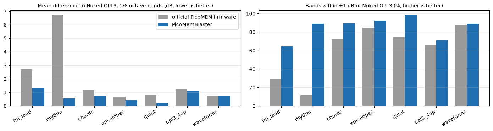
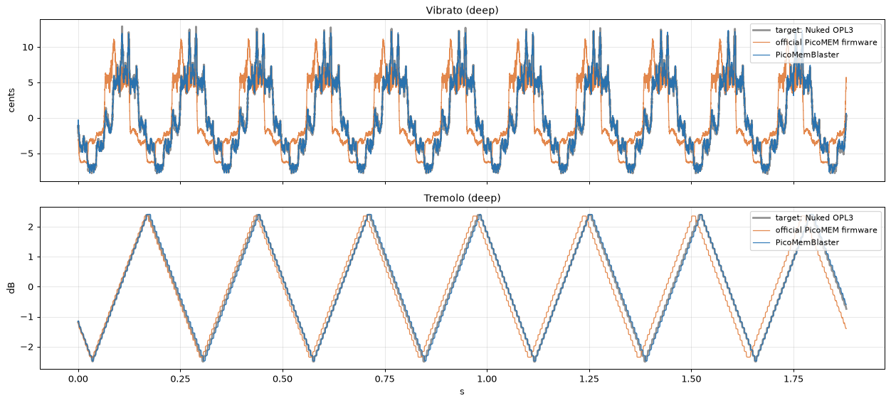
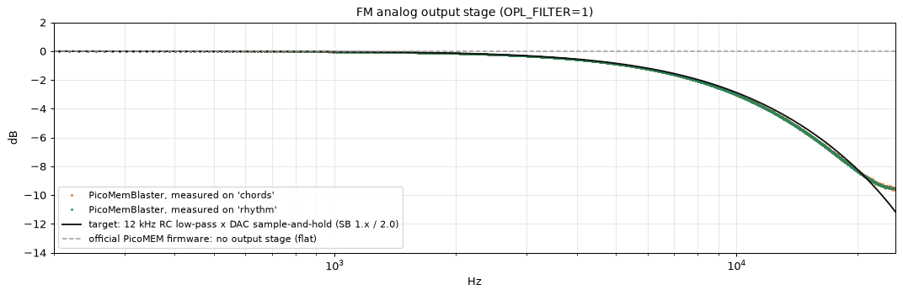

# PicoMemBlaster audio quality

How the PicoMemBlaster firmware sounds compared with the official PicoMEM firmware (PicoMEM 2 release
of October 4 2026), measured against a target for each part:

- **Sound Blaster digital audio** (and Covox / Disney): the output filter of a real Sound Blaster 16.
- **FM (OPL3)**: [Nuked OPL3](https://github.com/nukeykt/Nuked-OPL3), the cycle accurate YMF262
  emulator, fed the same register writes.

All curves come from a software-only analysis of the sample output, not from recordings of the
devices. The audio code of each firmware (the official PicoMEM firmware from its `origin/main`
sources, PicoMemBlaster from this repository) was built for a PC and fed the same input, and the
samples it produced were analysed directly, before any DAC or analog output. Both mix at
49 716 Hz (the OPL chip rate). Real cards were measured only for the SB16 filter target, by other
people (see below).

## Sound Blaster digital audio: band limiting

### Target: the SB16 output filter

A real Sound Blaster 16 plays its PCM through a very steep sinc ("brickwall") low-pass that moves
with the playback rate: flat up to half the rate, then a near vertical drop. At 11 kHz playback
nothing passes above 5.5 kHz, at 22 kHz nothing above 11 kHz, which also removes the aliasing of
the low rates most games use. **James-F** measured it on a real card with white noise and a spectrum
analyser (a drop of at least 60 dB, down to the analyser floor), see the Vogons thread
[DOSBox Sound Blaster emulation (Lowpass Filtering)](https://www.vogons.org/viewtopic.php?t=49802).

### Official PicoMEM firmware vs PicoMemBlaster vs the SB16 target

Full scale 8 bit white noise played through the Sound Blaster DMA path at each rate (the DSP time
constants 131, 166, 211, and 233), the output spectrum divided by the input spectrum: the response
of the whole resampler, including the images and aliases it adds above half the rate (shaded,
where the SB16 is silent).

| Playback rate | Response at 0.4 x rate, official PicoMEM firmware | PicoMemBlaster | Energy above rate / 2, official PicoMEM firmware | PicoMemBlaster |
|---------------|---------------------------------------------------|-------------|--------------------------------------------------|-------------|
| 8 000 Hz      | -2.8 dB                                           | -0.4 dB     | -5 dB                                            | -49 dB      |
| 11 111 Hz     | -2.6 dB                                           | -0.2 dB     | -6 dB                                            | -49 dB      |
| 22 222 Hz     | -2.3 dB                                           | -0.0 dB     | -6 dB                                            | -51 dB      |
| 43 478 Hz     | -1.1 dB                                           | +0.1 dB     | -10 dB                                           | -58 dB      |

- **The official PicoMEM firmware** repeats each sample until the next one (nearest sample): the treble droops
  (sample-and-hold) and the images of the signal are only 5 to 10 dB down. At 8 and 11 kHz that
  is the familiar "fizz" above the music, unlike any Sound Blaster.
- **PicoMemBlaster** resamples through a 48 tap Kaiser windowed sinc, -6 dB at 0.46 x the rate (the
  kernel is in input samples, so the cutoff follows any rate with one table), stopband 50 to 65 dB.
  It follows the SB16 target; the real card's transition is a little steeper, and at 44 kHz the
  top of the band (above about 19 kHz) rolls off early.
- The same filter is used for the **Covox / Disney** outputs: the Disney Sound Source at its
  6 993 Hz FIFO rate, the Covox DAC at the rate the program writes it (measured from the write
  time stamps, as the SB Direct DAC, command 10h).
- `USE_LPF=0` in `src/CMakeLists.txt` goes back to sample-and-hold (no 12 KB kernel in RAM).

## FM: faithfulness to the OPL3 chip

### Official PicoMEM firmware vs the target (Nuked OPL3)

### PicoMemBlaster vs the target (Nuked OPL3)

Same register writes into both, 16 bit chip output (before the analog stage below), aligned to the
best lag. Left: the target, middle: the firmware, right: the difference in 1/6 octave bands (red:
louder than the chip, blue: quieter, grey: both silent). The band difference is the timbre
comparison; the waveform SNR also counts harmless phase differences.

| Test | Mean band difference, official PicoMEM firmware | PicoMemBlaster | Bands within ±1 dB, official PicoMEM firmware | PicoMemBlaster |
|---|---|---|---|---|
| FM lead (feedback, vibrato, tremolo) | 2.71 dB | 1.32 dB | 29 % | 64 % |
| OPL2 rhythm mode (drums) | 6.73 dB | 0.56 dB | 12 % | 89 % |
| Chords, 6 voices | 1.21 dB | 0.73 dB | 73 % | 90 % |
| Piano / brass / bass envelopes | 0.64 dB | 0.41 dB | 85 % | 92 % |
| Quiet passage (-30 dB) | 0.81 dB | 0.21 dB | 74 % | 98 % |
| OPL3 4-op, stereo | 1.27 dB | 1.10 dB | 66 % | 71 % |
| Waveforms 0-7 | 0.76 dB | 0.70 dB | 87 % | 89 % |

Fixes made to the OPL emulation (checked sample by sample against Nuked OPL3):

- **Drums (rhythm mode)** were written as mono into the stereo buffer: garbled (the red columns of
  the official PicoMEM firmware plate) - fixed. The hi-hat, snare, and top cymbal now follow the chip's 23 bit
  noise generator. Corrected the chip's phase bit combinations for the hi-hat and cymbal, the
  snare's noise polarity, the cymbal phase (0x80 / 0x280), the waveform table offsets (drums
  using waveforms 0, 5, 6, 7 were sign flipped or misplaced) and the chip's timing (phases before
  their step, the hi-hat using the cymbal bits of the previous sample). Drums went from random-like
  to following the chip: waveform SNR -1.7 -> 8.8 dB (21.9 dB on the right channel), 89 % of the
  bands within ±1 dB.
- **FM modulation timing**: the carrier used the modulator output of the previous sample. FM with
  feedback is now sample-identical to the chip.
- **Chip arithmetic**: Fixed the sign handling (the official PicoMEM firmware
  multiplied a linear sine). Sine and waveforms 22 dB closer to the chip.
- **Waveform 7** started half a period off.
- **Vibrato and tremolo** made exact (rate, depth, and phase):

  

- **Envelopes** step on the chip's shared envelope clock, with the exact attack rates: 55 % of the
  envelope samples identical to the chip (35 % in the official PicoMEM firmware), release timing error 9.3 -> 1.7 ms.
- **OPL3 mode**: drums panned with their channels, second register array behaviour as the chip.

What is not fixed:
- DBOPL spreads each envelope rate evenly where the chip uses an uneven 4-step pattern
(short streaks at note starts in the lowest bands), deep FM chains magnify 1 LSB differences, and
the chip outputs its left channel before computing the drum, snare, and cymbal elements (one
sample, 20 µs, of skew on the left that only a sample-by-sample comparison shows).
Matching them exactly would need Nuked OPL3 itself, about twice the CPU, but the near 
undistinguishable acoustic difference is not worth the PicoMEM CPU cost.

### Analog output stage

The chip's 16-bit output then goes through the card: the DAC holds each sample, an RC low-pass
smooths it, and a coupling capacitor removes the DC. PicoMemBlaster simulates it (`OPL_FILTER`):
1 (default) Sound Blaster 1.x / 2.0, 12 kHz; 2 Sound Blaster Pro, 8 kHz; 0 none, as the SB16
(whose FM output is unfiltered). The official PicoMEM firmware has no output stage.

## CPU and RAM cost

Instruction counts of the firmware audio code on a Cortex-M33 (emulated), at the 49 716 Hz mixer
rate, as the share of the processing power of one RP2350 core running at 360 MHz they use (an estimate).

|                              | Official PicoMEM firmware              | PicoMemBlaster      | Difference |
|------------------------------|----------------------------------------|------------------|------------|
| FM, 9 voices (OPL2)          | 13.2 %                                 | 15.0 %           | +1.8 %     |
| FM, 18 voices (OPL3)         | 25.6 %                                 | 28.4 %           | +2.8 %     |
| FM, OPL2 drums               | 11.9 %                                 | 13.9 %           | +2.1 %     |
| SB 8 bit DMA, 11 kHz         | 0.4 %                                  | 3.8 %            | +3.4 %     |
| SB 8 bit DMA, 22 kHz         | 0.5 %                                  | 3.9 %            | +3.5 %     |
| SB 8 bit DMA, 44 kHz         | 0.6 %                                  | 4.2 %            | +3.6 %     |
| Covox DAC, written at 22 kHz | 2.9 % (43 478 timer interrupts / s)    | 4.6 % (no timer) | +1.8 %     |

RAM: +19 KB static (12 KB filter kernel, 5.5 KB SB Direct DAC buffer, 0.9 KB OPL), +4.3 KB while
the Covox DAC is on. The SB / Covox cost is the band-limited filter (`USE_LPF=0` removes it), the
FM cost is the analog stage (0.9 % while FM is on, `OPL_FILTER=0` removes it) and the chip
arithmetic (about 0.1 % per playing voice).
