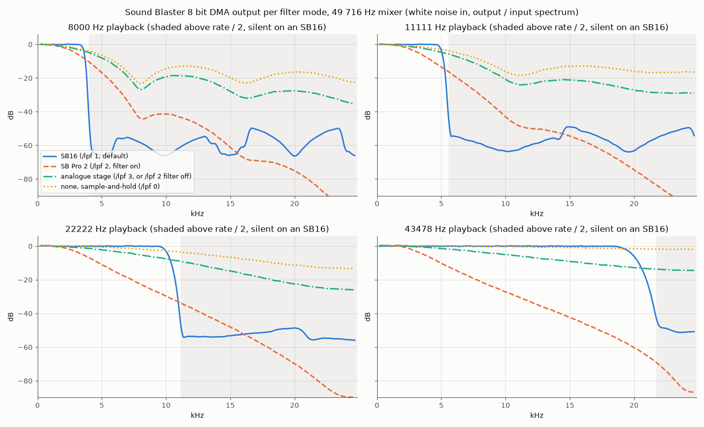

# PicoMemBlaster audio quality

This page compares the sound of the PicoMemBlaster firmware with the official PicoMEM firmware
(PicoMEM 2 release of October 4 2026). Each part is measured against a target.

The **Sound Blaster digital audio** (and the Covox / Disney) is compared with the output filter of a
real card. PicoMemBlaster has four filter modes, chosen at run time with `PMINIT /lpf x`.

The **FM (OPL3)** is compared with [Nuked OPL3](https://github.com/nukeykt/Nuked-OPL3), the cycle
accurate YMF262 emulator, fed the same register writes.

## Sound Blaster digital audio

### The output filter modes

Each Sound Blaster model filters its output in its own way. `PMINIT /lpf x` selects how
PicoMemBlaster filters the SB DMA, SB Direct DAC, Covox and Disney outputs.

| `/lpf` | Mode | What it does |
|---|---|---|
| 0 | None | Each sample is held until the next one (sample-and-hold), as in the official PicoMEM firmware. |
| 1 | SB16 (default) | A band-limited resampler that cuts just below half of the playback rate, as the SB16 does. |
| 2 | SB Pro 2 | The fixed 3.2kHz output low-pass of the SB Pro, which the program can switch off, then the card analogue stage. |
| 3 | Analogue stage | Only the card analogue stage, an 8kHz RC low-pass and DC blocking. |

Mode 1 needs the 12KB filter kernel. A firmware built with `USE_LPF=0` has no SB16 mode and starts
in mode 0.

### Targets measured on real cards

The **SB16** plays its PCM through a very steep sinc ("brickwall") low-pass that moves with the
playback rate. It is flat up to half the rate and then drops sharply. At 11kHz playback nothing
passes above 5.5kHz, and at 22kHz nothing passes above 11kHz. This also removes the aliasing of the
low rates most games use. **James-F** measured it on a real card with white noise and a spectrum
analyser, with a drop of at least 60dB down to the analyser floor. See the Vogons thread
[DOSBox Sound Blaster emulation (Lowpass Filtering)](https://www.vogons.org/viewtopic.php?t=49802).

The **SB Pro 2** has a fixed low-pass in its CT1345 mixer chip. Creative's *Sound Blaster Series
Hardware Programming Guide* gives it as 3.2kHz and on by default. It tells programs to turn it off
(mixer register 0Eh bit 5) for high sampling rates or stereo. Recordings of real cards show a 2nd
order (12dB per octave) slope, in the measurements linked in
[dosbox-staging issue #1674](https://github.com/dosbox-staging/dosbox-staging/issues/1674).
PicoMemBlaster uses a 2nd order Butterworth low-pass at 3.2kHz and follows the on and off requests
of the program.

The **analogue stage** after the DAC is the same as on the SB Pro FM output (see the FM section
below). It is an 8kHz RC low-pass and a coupling capacitor that removes the DC. No measurement of
the SB Pro digital audio path with its 3.2kHz filter off was found, so this is an assumption.

### Response of each mode

Full scale 8-bit white noise was played through the Sound Blaster DMA path at each rate (DSP time
constants 131, 166, 211 and 233). The output spectrum was divided by the input spectrum. The curves
show the response of the whole output, including the images and aliases it adds above half the rate
(shaded), where an SB16 is silent.

| Playback rate | Mode | Response at 0.4 x rate | Energy above rate / 2 |
|---|---|---|---|
| 8000Hz | None | -2.6dB | -7dB |
| | SB16 | -0.2dB | -49dB |
| | SB Pro 2 (filter on) | -6.3dB | -18dB |
| | Analogue stage | -3.3dB | -10dB |
| 11111Hz | None | -2.6dB | -7dB |
| | SB16 | -0.2dB | -49dB |
| | SB Pro 2 (filter on) | -10.8dB | -25dB |
| | Analogue stage | -3.9dB | -11dB |
| 22222Hz | None | -2.4dB | -7dB |
| | SB16 | -0.2dB | -51dB |
| | SB Pro 2 (filter on) | -25.9dB | -43dB |
| | Analogue stage | -6.4dB | -15dB |
| 43478Hz | None | -1.3dB | -10dB |
| | SB16 | -0.1dB | -58dB |
| | SB Pro 2 (filter on) | -50.2dB | -85dB |
| | Analogue stage | -11.0dB | -23dB |

**None** is the sound of the official PicoMEM firmware. The treble droops from the sample-and-hold,
and the images of the signal are only 7 to 10dB down. At 8 and 11kHz this gives the familiar "fizz"
above the music, unlike any Sound Blaster.

**SB16** resamples through a 48 tap Kaiser windowed sinc, -6dB at 0.46 x the rate, with a stopband
of 50 to 65dB. The kernel is defined in input samples, so one table gives the same cutoff at any
rate. It follows the SB16 target. The transition of the real card is a little steeper, and at 44kHz
the top of the band (above about 19kHz) rolls off early.

**SB Pro 2** with the filter on keeps everything above 3.2kHz down at every rate. This gives the
muffled SB Pro sound at 22 and 44kHz, which is why Creative tells programs to switch it off for high
rates and stereo. With the filter off it is the same as the analogue stage.

**Analogue stage** softens the sample-and-hold output by 3 to 13dB more than mode 0. It is the plain
sound of an SB Pro with its filter off. It reduces the harshness without muffling the sound.

### DACs written by the CPU

The program writes the SB Direct DAC (command 10h) and the Covox DAC one sample at a time from a
timer interrupt. Other interrupts delay that timer, so the samples don't come at an even rate. In
Jill of the Jungle the FM music handler runs every 16 samples.

The ISA core time stamps each write, and the write is replayed at its real time, 10ms behind. Each
output sample is the mean DAC level over its 20us, so a write in the middle of an output sample
isn't moved to its start or end. The result then goes through the filter of the mode. The SB16 mode
gives these DACs the analogue stage only because the SB16 filter needs evenly spaced samples.

A band-limited filter at the measured write rate jumps at each late write. The test below writes a
1kHz tone at the Jill of the Jungle rate (6088Hz), with every 16th write 0.6 period late. The
largest step between two output samples shows the difference.

| Direct DAC in the SB16 mode | Writes on time | Every 16th write late |
|---|---|---|
| Band-limited at the measured rate | 836 | 4885 (about 440 jumps per second, heard as crackle) |
| Timed replay, analogue stage | 3049 | 3140 |

The remaining difference between the timed replay and perfectly even writes (-15dB at 1kHz) is the
real timing jitter of the program, which a real card plays too.

The Disney Sound Source plays from a FIFO at a steady 6993Hz, so it gets the SB16 filter.

## FM faithfulness to the OPL3 chip

### Official PicoMEM firmware vs the target (Nuked OPL3)

### PicoMemBlaster vs the target (Nuked OPL3)

The same registers were written into both, and the plots show the 16-bit chip output before the
analogue stage. The left plot is the target, the middle one the firmware, and the right one the
difference in 1/6 octave bands. Red is louder than the chip, blue quieter and grey silent in both.
The band difference is the timbre comparison. The waveform SNR also counts harmless phase
differences.

| Test | Mean band difference, official PicoMEM firmware | PicoMemBlaster | Bands within ±1dB, official PicoMEM firmware | PicoMemBlaster |
|---|---|---|---|---|
| FM lead (feedback, vibrato, tremolo) | 2.71dB | 1.32dB | 29% | 64% |
| OPL2 rhythm mode (drums) | 6.73dB | 0.56dB | 12% | 89% |
| Chords, 6 voices | 1.21dB | 0.73dB | 73% | 90% |
| Piano / brass / bass envelopes | 0.64dB | 0.41dB | 85% | 92% |
| Quiet passage (-30dB) | 0.81dB | 0.21dB | 74% | 98% |
| OPL3 4-op, stereo | 1.27dB | 1.10dB | 66% | 71% |
| Waveforms 0-7 | 0.76dB | 0.70dB | 87% | 89% |

These fixes to the OPL emulation were checked sample by sample against Nuked OPL3.

The **drums (rhythm mode)** were written as mono into the stereo buffer, which garbled them. These
are the red columns of the official PicoMEM firmware plot. The hi-hat, snare and top cymbal now
follow the 23 bit noise generator of the chip. The phase bit combinations for the hi-hat and
cymbal, the noise polarity of the snare, the cymbal phase (0x80 / 0x280) and the waveform table
offsets are now as on the chip. The drums using waveforms 0, 5, 6 and 7 were sign flipped or
misplaced. The timing follows the chip too, with the phases before their step and the hi-hat using
the cymbal bits of the previous sample. The drums now follow the chip, with a waveform SNR going
from -1.7 to 8.8dB and 89% of the bands within ±1dB.

The **FM modulation timing** was off by a sample because the carrier used the modulator output of
the previous sample. FM with feedback is now sample-identical to the chip.

The **chip arithmetic** had wrong sign handling, and the official PicoMEM firmware multiplied a
linear sine. The sine and the other waveforms are now 22dB closer to the chip.

**Waveform 7** started half a period off.

**Vibrato and tremolo** are now exact in rate, depth and phase.

The **envelopes** step on the shared envelope clock of the chip, with the exact attack rates. 55% of
the envelope samples are identical to the chip (35% in the official PicoMEM firmware), and the
release timing error went from 9.3ms to 1.7ms.

In **OPL3 mode** the drums are panned with their channels, and the second register array behaves
as on the chip.

Some differences are not fixed. DBOPL spreads each envelope rate evenly where the chip uses an
uneven 4-step pattern, which leaves short streaks at note starts in the lowest bands. Deep FM chains
magnify 1 LSB differences. The chip outputs its left channel before computing the drum, snare and
cymbal elements, a one sample (20µs) skew on the left that only a sample-by-sample comparison
shows. Matching them exactly would need Nuked OPL3 itself, which costs about twice the CPU and does
not fit on a PicoMEM.

### Analogue output stage

The 16-bit output of the chip then goes through the card. The DAC holds each sample, an RC low-pass
smooths it, and a coupling capacitor removes the DC. PicoMemBlaster simulates this stage, selected
with `OPL_FILTER` at build time. The default 1 is the Sound Blaster 1.x / 2.0 at 12kHz, 2 is the
Sound Blaster Pro at 8kHz, and 0 is none, as on the SB16, whose FM output is unfiltered. The
official PicoMEM firmware has no output stage. The SB Pro 2 and analogue stage filter modes of the
digital audio use the same 8kHz SB Pro stage.

## CPU and RAM cost

The table gives the share of one RP2350 core at 360MHz used by the firmware audio code, at the
49716Hz mixer rate. It is an estimate from instruction counts on an emulated Cortex-M33. The SB rows
are for the default SB16 filter mode.

|                              | Official PicoMEM firmware              | PicoMemBlaster   | Difference |
|------------------------------|----------------------------------------|------------------|------------|
| FM, 9 voices (OPL2)          | 13.2%                                  | 15.0%            | +1.8%      |
| FM, 18 voices (OPL3)         | 25.6%                                  | 28.4%            | +2.8%      |
| FM, OPL2 drums               | 11.9%                                  | 13.9%            | +2.1%      |
| SB 8-bit DMA, 11kHz          | 0.4%                                   | 3.8%             | +3.4%      |
| SB 8-bit DMA, 22kHz          | 0.5%                                   | 3.9%             | +3.5%      |
| SB 8-bit DMA, 44kHz          | 0.6%                                   | 4.2%             | +3.6%      |
| Covox DAC, written at 22kHz  | 2.9% (43478 timer interrupts / s)      | 4.6% (no timer)  | +1.8%      |

The SB16 mode costs the most because its filter does 48 multiplies per output sample. The SB Pro 2
mode does 8, the analogue stage 3 and mode 0 none.
The Covox row was measured with a sinc filter on the CPU-written DACs. The timed replay
has no sinc filter, so it costs less than shown.

The firmware uses about 19KB more static RAM. That is 12KB for the SB16 filter kernel, 5.1KB for
the SB Direct DAC buffer, 0.8KB for the SB Pro 2 mixer and stereo output, and 0.9KB for the OPL.
The Covox DAC allocates another 5.1KB buffer while it is on. `USE_LPF=0` removes the 12KB kernel
and the SB16 mode. The FM cost is the analogue stage (0.9% while FM is on, removed by
`OPL_FILTER=0`) and the chip arithmetic (about 0.1% per playing voice).
